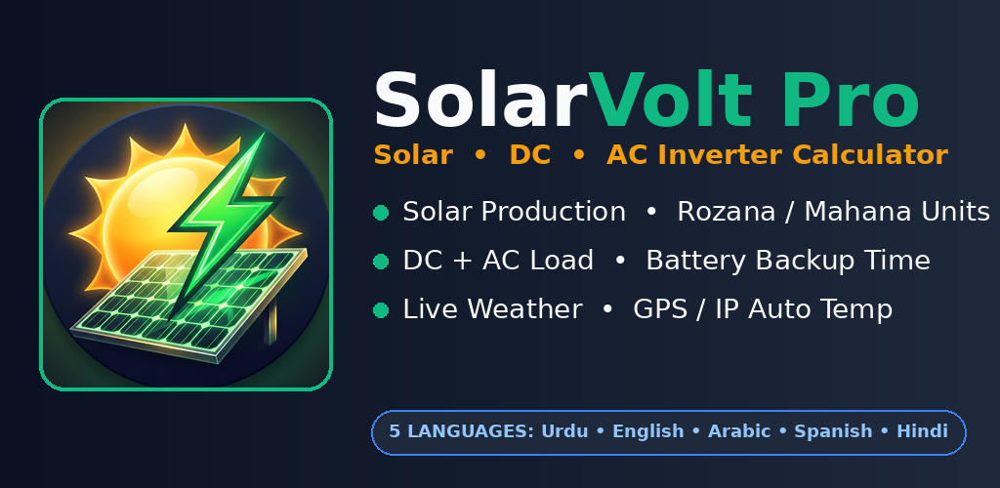

# SolarVolt Pro

**Solar • DC • AC Inverter Calculator**

Apne solar system ka mukammal hisaab — aik hi app mein.

## Features

- **Solar Production** — Panels 585W • 600W • 700W • Custom, rozana / mahana Units (kWh), efficiency slider 50% se 95%, live hisaab
- **DC + AC Load** — DC Fans 35W • DC Lights 12W, AC Fans 80W • Inverter Fans 35W, Fridge • Inverter AC • TV / Lights, +12% Inverter Loss shamil
- **Battery Backup** — 12V • 24V • 48V Battery Bank, battery size 100Ah — 250Ah, backup time ghante / minute mein, solar status — chalega ya nahi
- **Live Weather & Temp** — GPS se live temperature, GPS band ho to IP se sheher ka mausam, 25°C se upar har degree = 0.35% kami, manual temp box
- **5 Languages** — Urdu (mukammal RTL support) • English • Arabic (mukammal RTL support) • Spanish • Hindi

## Sample Result

| | |
|---|---|
| Total Solar | 2340 W (2.34 kW) |
| Daily Units | 9.65 kWh |
| Monthly Units | 289.6 kWh |
| DC Load | 118 W |
| AC Load (with loss) | 459 W |
| Total Load | 577 W |
| Battery Bank | 12V • 200Ah |
| Backup Time | 2 hrs 5 mins |
| Live Temp (sample) | 40°C, Heat Loss 5.25%, Daily (adjusted) 8.98 kWh |

## Use

`index.html` ko browser mein kholein — koi install ya server nahi chahiye.

## Posters & Video

- `assets/` mein feature graphic aur posters hain
- `assets/promo.mp4` mein SolarVolt Pro ki promo video hai

Crafted by **Silkyline Studio**
